<div id="top" align="center">

  <!-- SpaceSage Celestial Astrolabe Logo -->
  <a href="#top">
    
  </a>

  <br/><br/>

  <!-- SpaceSage Animated Cosmic Banner with Typing Text Animation -->
  <a href="#top">
    
  </a>

  <br/><br/>

  <p align="center">
    <strong>Ultra-fast cosmic disk space analyzer, proportional treemap, and safe storage cleaner for Linux.</strong>
    <br/>
    <em>Go from "My disk is full" to "I reclaimed 20 GB" in seconds — with complete Trash safety.</em>
  </p>

  <p align="center">
    <a href="https://github.com/emirkefi/spacesage/releases"></a>
    <a href="#license"></a>
    <a href="https://www.rust-lang.org/"></a>
    <a href="#performance"></a>
    <a href="https://archlinux.org/"></a>
  </p>

  <p align="center">
    <a href="#quick-start"><strong> Quick Install</strong></a> &nbsp;&bull;&nbsp;
    <a href="#why-spacesage"><strong> Why SpaceSage?</strong></a> &nbsp;&bull;&nbsp;
    <a href="#features"><strong> Features</strong></a> &nbsp;&bull;&nbsp;
    <a href="#keybindings"><strong> Keybindings</strong></a> &nbsp;&bull;&nbsp;
    <a href="#tree-nav"><strong> Navigation Tree</strong></a> &nbsp;&bull;&nbsp;
    <a href="#license"><strong> License</strong></a>
  </p>

</div>

---

<!-- Live Application Screenshot Section -->
<div align="center">
  
  <p><em>Interactive explorer dashboard featuring live partition gauges, Nerd Font icons, proportional inline bars, and multi-threaded scanning telemetry.</em></p>
</div>

---

<a id="tree-nav"></a>
##  Quick Directory & Feature Tree

Navigate directly to any section of the documentation:

```text
 SpaceSage Documentation
│
├──  [Quick Start & Installation](#quick-start)
│   ├──  [1-Line Fast Install Script](#install-script)
│   ├──  [Cargo / Crates.io](#install-cargo)
│   ├──  [Arch Linux (AUR / PKGBUILD)](#install-arch)
│   ├──  [Building from Source](#install-source)
│   └──  [Uninstallation Guide](#uninstall)
│
├──  [Why SpaceSage?](#why-spacesage)
│   ├──  [The Philosophy: From Detection to Safe Reclamation](#why-spacesage)
│   └──  [Comparison vs Traditional Tools (ncdu, dust, gdu)](#comparison-matrix)
│
├──  [Core Features](#features)
│   ├──  [Fullscreen Interactive Proportional Treemap (`t`)](#treemap)
│   ├──  [Top-N Recursive File Detective (`f`)](#top-files)
│   ├──  [Safe Two-Layer Deletion Engine (`d` / `D`)](#trash-engine)
│   ├──  [System Path Protection & Sudo Handling](#safety-protection)
│   ├──  [Adaptive Themes & Nerd Font Glyphs](#themes)
│   └──  [High-Performance Scanner Engine (jwalk + FxHashMap)](#performance)
│
├──  [Interactive Keybindings & Navigation](#keybindings)
│   ├──  [Essential Keybindings](#keybindings-quick)
│   └── ️ [Comprehensive Key & Mouse Map](#keybindings-all)
│
├── ⚙️ [CLI Usage & Configuration](#configuration)
│   ├──  [Command-Line Flags & Arguments](#cli-flags)
│   ├──  [Configuration File (`config.toml`)](#config-file)
│   └──  [Scripting & JSON/CSV Headless Exports](#export-scripting)
│
├── ️ [Project Roadmap](#roadmap)
│
└──  [License & Terms of Use](#license)
```

---

<a id="quick-start"></a>
##  Quick Start & Installation

Install **SpaceSage** in seconds using any of the methods below:

<a id="install-script"></a>
###  One-Line Automatic Install Script

The fastest way to install or update SpaceSage on any Linux system:

```bash
curl -fsSL https://raw.githubusercontent.com/emirkefi/spacesage/master/install.sh | bash
```

> [!NOTE]
> The script automatically installs `spacesage` into `~/.local/bin` (or `/usr/local/bin` if privileged). It verifies your `$PATH` and tests the binary immediately.

<a id="install-cargo"></a>
###  Cargo / Rust

If you have Rust installed:

```bash
cargo install spacesage
```

Run SpaceSage instantly on any directory:

```bash
spacesage ~
```

<a id="install-arch"></a>
### 🏹 Arch Linux

For Arch Linux users, compile and install locally with `makepkg`:

```bash
git clone https://github.com/emirkefi/spacesage.git
cd spacesage
makepkg -si
```

<a id="install-source"></a>
###  Building From Source

```bash
git clone https://github.com/emirkefi/spacesage.git
cd spacesage
cargo build --release
sudo make install
```

<a id="uninstall"></a>
###  Uninstallation

SpaceSage leaves no residue behind:

```bash
curl -fsSL https://raw.githubusercontent.com/emirkefi/spacesage/master/uninstall.sh | bash
# Or from the source checkout:
sudo make uninstall
```

---

<a id="why-spacesage"></a>
##  Why SpaceSage?

Most disk analyzers (like `du` or `ncdu`) answer only one question: **"What is taking up space?"**  
They leave you staring at an unfamiliar 18 GB `.cache` or `target` folder, terrified that deleting it might break your system or development environment.

SpaceSage is engineered around the question you actually care about:  
<p align="center"><strong>"What can I safely get rid of right now to reclaim my disk?"</strong></p>

<a id="comparison-matrix"></a>
###  Feature Comparison Matrix

| Capability | SpaceSage 🪐 | Traditional `ncdu` | `dust` / `gdu` |
|:---|:---:|:---:|:---:|
| **Scanning Speed** |  **Ultra-fast** (Multi-threaded `jwalk` + `FxHash`) | 🐢 Single-threaded | ⚡ Fast |
| **Visual Treemap** |  **Interactive Fullscreen Squarified Treemap** (`t`) | ❌ None | ❌ None |
| **Top Heavy Files** |  **Instant Top-N Largest Files Inspector** (`f`) | ❌ None | ❌ None |
| **Deletion Safety** |  **FreeDesktop Trash (`d`) with Undo Metadata** | ⚠️ Permanent Only | ⚠️ Permanent Only |
| **System Protection**|  **Blocks accidental `/`, `/bin`, `/etc` deletion** | ⚠️ No Safety Checks | ⚠️ No Safety Checks |
| **Batch Selection** |  **Multi-select items with `Space`** | ❌ One at a time | ❌ One at a time |
| **Color Palettes** |  **Arch Ice-Blue, Catppuccin, Gruvbox, Mono** | 🔘 Basic ANSI | 🎨 Standard |
| **Headless Export** | 📤 **Full JSON & CSV tree export for pipelines** | ❌ Limited | ❌ Limited |

---

<a id="features"></a>
##  Core Features

<a id="treemap"></a>
###  Fullscreen Interactive Proportional Treemap (`t`)
Press <kbd>t</kbd> anywhere in SpaceSage to toggle a fullscreen, 2D squarified proportional treemap.
- Visualizes exactly which folders and files dominate storage as proportional blocks.
- Navigate across blocks with <kbd>h</kbd>/<kbd>j</kbd>/<kbd>k</kbd>/<kbd>l</kbd> or arrow keys.
- Press <kbd>Enter</kbd> to zoom into any subfolder block, or <kbd>Esc</kbd> / <kbd>t</kbd> to return to the explorer list.

<a id="top-files"></a>
###  Top-N Recursive File Detective (`f`)
Press <kbd>f</kbd> to switch to the Top-N Largest Files page.
- Aggregates the heaviest individual files across the entire analyzed subtree.
- Pinpoint giant ISOs, container layers, videos, or forgot-about archives in a single glance.
- Press <kbd>Enter</kbd> on any file in the list to reveal and jump directly to its parent folder.

<a id="trash-engine"></a>
###  Safe Two-Layer Deletion Engine (`d` / `D`)
Deleting files should never be nerve-wracking:
- **Soft Trash (<kbd>d</kbd>)**: Moves marked or highlighted items directly to your desktop's FreeDesktop Trash (`$XDG_DATA_HOME/Trash` or `~/.local/share/Trash`). Writes valid `.trashinfo` metadata with original path and timestamp so you can restore anything via your file manager.
- **Permanent Purge (<kbd>D</kbd> or <kbd>Del</kbd>)**: When you genuinely want to destroy data permanently, SpaceSage prompts with a high-contrast safety modal displaying the exact target list and total size.
- **Batch Operations (<kbd>Space</kbd>)**: Mark multiple directories or files in different branches, inspect the aggregated total size in the bottom bar, and delete or trash them simultaneously.

<a id="safety-protection"></a>
###  System Path Protection & Privilege Guard
SpaceSage includes built-in safety heuristics to protect your Linux installation:
- Root filesystem protection: Deleting `/` is strictly forbidden under all circumstances.
- Active scan root protection: You cannot delete the root of your currently active scan.
- Critical system directories (`/bin`, `/sbin`, `/usr`, `/lib`, `/boot`, `/etc`, `/dev`, `/proc`, `/sys`) cannot be deleted by non-root users.
- If a folder requires administrative privileges, SpaceSage shows a clean `[needs sudo]` badge and allows retrying seamlessly via `sudo spacesage <path>`.

<a id="themes"></a>
###  Adaptive Themes & Visual Styling
SpaceSage looks stunning out of the box with the signature Arch ice-blue cyberpunk theme.
- **Theme presets**: `arch` (default), `catppuccin` (Macchiato), `gruvbox`, `mono`, and `no_color`.
- **Dynamic partition gauge**: Tracks total filesystem utilization, shifting from calm cyan to vivid amber (>70%) and alert crimson (>90%).
- **Icon support**: Automatic detection of Nerd Fonts (`auto`), with fallbacks to clean Unicode or ASCII glyphs.

<a id="performance"></a>
###  High-Performance Scanner Engine
Engineered from the ground up for extreme speed on massive drives (+100 GB, +1,000,000 files):
- **Lock-free parallel traversal**: Powered by `jwalk` multi-threaded worker pools.
- **Fast hashing & memory efficiency**: Utilizes `rustc-hash` (`FxHashMap`) and zero-copy string path slices.
- **Accurate filesystem semantics**: Hard links counted once, symlinks never followed in circles, pseudo-filesystems (`/proc`, `/sys`, `/dev`, `/run`) skipped automatically.
- **One-filesystem boundary (`-x`)**: Restrict analysis to a single mount point (identical to `du -x`).

---

<a id="keybindings"></a>
##  Interactive Keybindings & Controls

<a id="keybindings-quick"></a>
###  Essential Controls

| Key | Action |
|:---:|:---|
| <kbd>j</kbd> / <kbd>k</kbd> | Move cursor down / up |
| <kbd>l</kbd> / <kbd>Enter</kbd> | Enter highlighted directory |
| <kbd>h</kbd> / <kbd>Backspace</kbd> | Go to parent directory (preserves cursor history) |
| <kbd>Space</kbd> | Mark / unmark item for batch actions |
| <kbd>d</kbd> | Move selected or marked items to **Trash** (recoverable) |
| <kbd>D</kbd> | **Permanently delete** selected or marked items |
| <kbd>t</kbd> | Toggle **Fullscreen Proportional Treemap** |
| <kbd>f</kbd> | Toggle **Top-N Largest Files** view |
| <kbd>?</kbd> / <kbd>q</kbd> | Open help guide / Quit |

<a id="keybindings-all"></a>
###  Comprehensive Key & Mouse Reference

<details>
<summary><strong>Click to expand full key & mouse control reference</strong></summary>
<br/>

| Input | Scope | Action |
|:---:|:---:|:---|
| <kbd>j</kbd> / <kbd>k</kbd> / <kbd>↓</kbd> / <kbd>↑</kbd> | Navigation | Move cursor selection down or up |
| <kbd>g</kbd> / <kbd>G</kbd> | Navigation | Jump to first / last item |
| <kbd>Ctrl+d</kbd> / <kbd>Ctrl+u</kbd> | Navigation | Jump half-page down / half-page up |
| <kbd>l</kbd> / <kbd>Enter</kbd> | Navigation | Enter folder (or locate file from Top-N view) |
| <kbd>h</kbd> / <kbd>Backspace</kbd> | Navigation | Go back to parent folder (restores previous cursor position) |
| <kbd>~</kbd> | Navigation | Jump directly to your `$HOME` folder |
| <kbd>Mouse Scroll</kbd> | Navigation | Scroll through folder listings smoothly |
| <kbd>Double Click</kbd> | Navigation | Open selected folder |
| <kbd>Right Click</kbd> | Navigation | Return to parent folder |
| <kbd>Space</kbd> | Batch Selection | Mark or unmark current item |
| <kbd>d</kbd> | Cleanup | Send selected or marked items to FreeDesktop Trash |
| <kbd>D</kbd> / <kbd>Del</kbd> | Cleanup | Permanently delete selected or marked items |
| <kbd>s</kbd> | Sorting | Cycle sort field: `Size` ➔ `Name` ➔ `Item Count` |
| <kbd>S</kbd> | Sorting | Toggle ascending / descending order |
| <kbd>/</kbd> | Search | Live interactive substring filter with match counter |
| <kbd>t</kbd> | Visualizer | Toggle fullscreen proportional treemap |
| <kbd>f</kbd> | Analytics | Toggle Top-N largest files view |
| <kbd>y</kbd> | Clipboard | Copy selected item's absolute path to system clipboard |
| <kbd>o</kbd> | System Integration | Open path in `$EDITOR` (if file) or via `xdg-open` |
| <kbd>T</kbd> | Styling | Cycle through color themes (`arch` ➔ `catppuccin` ➔ `gruvbox` ➔ `mono`) |
| <kbd>r</kbd> | Telemetry | Refresh live partition metrics and mount space |
| <kbd>?</kbd> | Help | Open interactive modal keyboard guide |
| <kbd>q</kbd> / <kbd>Ctrl+c</kbd> | System | Clean terminal exit |

</details>

---

<a id="configuration"></a>
##  CLI Usage & Configuration

<a id="cli-flags"></a>
###  Command-Line Flags

```bash
# Analyze current working directory
spacesage

# Analyze a specific directory
spacesage /var/log

# Scan root filesystem without crossing mount points (like du -x)
spacesage / -x

# Exclude specific folder names or patterns
spacesage ~ --exclude node_modules --exclude .git --exclude target

# Launch with custom theme and nerd font icons
spacesage ~ --theme catppuccin --icons nerd

# Headless JSON export for scripts and dashboards
spacesage /var --export-json /tmp/disk-report.json

# Headless CSV export for spreadsheet analysis
spacesage /var --export-csv /tmp/disk-report.csv
```

<a id="config-file"></a>
###  Configuration File (`config.toml`)

SpaceSage reads optional persistent configuration from:
`~/.config/spacesage/config.toml` (or `$XDG_CONFIG_HOME/spacesage/config.toml`)

```toml
# Color theme: "arch", "catppuccin", "gruvbox", "mono", "no_color"
theme = "arch"

# Icon glyphs mode: "auto", "nerd", "ascii", "none"
icons = "auto"

# Restrict scan to the same filesystem by default (like du -x)
one_file_system = false

# Persistent exclusion patterns
exclude = [
    "node_modules",
    ".git",
    "target",
    ".cache",
    ".rustup"
]
```

<a id="export-scripting"></a>
###  Scripting & Data Export

Integrate SpaceSage into automation pipelines, backup verification, or CI jobs:

```bash
# Export complete storage hierarchy as structured JSON
spacesage /home/user/Projects --export-json /tmp/audit.json

# Parse largest directories using jq:
jq '.children[] | {name: .name, size: .size_formatted}' /tmp/audit.json
```

---

<a id="roadmap"></a>
##  Project Roadmap

- [x] **v0.1**: Initial high-speed multi-threaded scanner with proportional gauge bars.
- [x] **v0.2**: Fullscreen proportional treemap page, Top-N file inspector, Trash engine (`d`/`D`).
- [x] **v0.2.1**: Modular architecture, zero-warning clippy baseline, thread-safe test runner.
- [ ] **v0.3**: Native packages for AUR (`spacesage-bin` & `spacesage-git`), Debian, and Fedora.
- [ ] **v0.4**: Rules engine explaining known application caches (pacman, yay, Docker, Cargo, npm, systemd journals).
- [ ] **v0.5**: Dedicated "Reclaimable Space" dashboard with safe 1-click cleanup recommendations.
- [ ] **v0.6**: Multi-platform support for macOS and Windows.

---

<a id="license"></a>
##  License & Terms of Use

**SpaceSage** is distributed under a proprietary personal-use freeware license.

###  Summary of Terms

- ** Permitted Use**: You are free to download, install, run, and use SpaceSage on any number of personal, educational, or internal organizational computers without charge.
- **❌ Modifications Restricted**: You may not modify, adapt, alter, reverse engineer, decompile, disassemble, or create derivative works of SpaceSage.
- **❌ Modified Redistribution Prohibited**: You may not distribute, sub-license, rent, or lease modified versions of this software. Redistribution of unmodified official binaries must retain all original copyright notices.

Read the complete [LICENSE](LICENSE) terms and [NOTICE](NOTICE) file for full legal provisions.

---

<div align="center">
  <p><strong>SpaceSage</strong> &bull; Crafted with 🦀 Rust for Linux by <a href="https://github.com/emirkefi">Emir Kefi</a></p>
  <p><a href="#top"><strong>▲ Back to top</strong></a></p>
</div>
